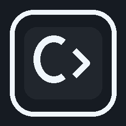

# CAssets CodeSight — DevReady for VS Code

<p align="center"></p>

<p align="center"><strong>Understand your code. See dependencies. Develop with confidence.</strong></p>

[Documentation](docs/README.md) · [Architecture](docs/ARCHITECTURE.md) · [Roadmap](docs/ROADMAP.md) · [VSIX acceptance](docs/CODESIGHT_A2_VSIX_ACCEPTANCE.md) · [Contributing](CONTRIBUTING.md)

**CAssets CodeSight** is a native-first VS Code developer companion for understanding unfamiliar repositories, finding evidence-backed dependencies, diagnosing workspace readiness, and running existing project tasks with developer approval.

**Publisher:** ClusterAssets · **Creator and principal architect:** Vivek Rao Bhosale · **Extension ID:** `clusterassets.cassets` · **Package:** `cassets` · **Current manifest version:** `0.7.0`.

[View the CodeSight architecture diagram](docs/images/codesight-architecture.svg)

## What you can do today

| Capability | Description |
| --- | --- |
| **Project Overview** | Inspect detected languages, package managers, scripts, runtime signals and workspace packages |
| **Architecture Explorer (A1/A2 work)** | Explore bounded static source-reference graphs with evidence lines, language filters, direction/depth controls, keyboard navigation and Mermaid export |
| **Workspace Doctor** | Inspect prerequisites and configuration gaps without pretending detection proves a successful build |
| **Run / Test / Debug** | Discover existing scripts and launch configurations; execution requires explicit developer action |
| **Task history and service readiness** | Distinguish observed task outcomes and explicitly configured local health checks |
| **Workstation readiness** | Prefer VS Code built-ins, preserve explicit settings and offer safe opt-in improvements |

Architecture edges are **provisional static references**, not verified runtime dependencies. Unknown or external references are reported separately; no architecture-conformance verdict is implied.

## Try it in VS Code

1. Install a CodeSight VSIX built by the repository's successful **Package VSIX** GitHub Actions job, or build locally after `npm ci` with `npm run package:pre -- --out codesight-test.vsix`.
2. In VS Code, run **Extensions: Install from VSIX…**, select the package and reload.
3. Open a trusted repository and run **CAssets: Open Project Overview** or **CAssets: Discover Source Architecture** from the Command Palette.
4. Select a source file, inspect evidence-backed edges and open a referenced source line. Compare the results against the actual code.
5. Use **CAssets: Run Workspace Doctor** to inspect readiness; review recommendations before running commands or creating files.

For Windows PowerShell, use `npm ci`, `npm run validate`, `npm run test:unit`, and `npm run package:pre -- --out codesight-test.vsix`. For Linux headless integration, use `xvfb-run -a npm run test:integration`.

**Release status:** A2 acceptance is **pending**. A passing build and successful local VSIX installation are required before publishing a stable release or starting A3. See the [acceptance checklist](docs/CODESIGHT_A2_VSIX_ACCEPTANCE.md).

## How CodeSight works

[View the CodeSight feature workflow diagram](docs/images/codesight-workflow.svg)

CodeSight uses bounded repository reads and VS Code APIs. Workspace Trust gates sensitive inspection and execution paths. Existing repository files remain developer-owned; no repository instructions are executed just because they appear in source files. The extension does not silently upload repository contents or install dependencies.

## Roadmap at a glance

| Stage | Scope | Status |
| --- | --- | --- |
| Foundation | Native-first readiness, project understanding, workspace doctor, native run/test/debug | Implemented incrementally; continuing validation |
| **A1** | Static source-reference discovery with evidence and language coverage | Implemented |
| **A2** | Interactive Architecture Explorer, navigation, graph bounds, multi-root security | Implemented in parts; **release acceptance pending** |
| **A2 release gate** | Real VS Code VSIX install, CI, keyboard/source-opening tests, performance and icon parity | **Pending** |
| **A3** | Evidence-based architecture conformance and deviation detection | Planned; not started |
| Later | Change-impact intelligence, incremental indexing, verified architectural insights | Research / planned |

See the detailed [roadmap](docs/ROADMAP.md).

## Development

```bash
npm ci
npm run validate
npm run test:unit
npm run test:integration
npm run package:pre -- --out codesight-test.vsix
```

The CI pipeline also performs security checks and creates a downloadable VSIX artifact when its required jobs pass. No test or installation result is claimed by this README.

## Design principles

- **Native first:** prefer VS Code's own functionality over redundant extensions.
- **Evidence before claims:** distinguish observed code, inferred relationships and verified execution.
- **Developer in control:** explicit approval for execution or file creation; no surprise changes.
- **Bounded and local:** limited scans, cautious handling of untrusted content, no mandatory cloud account.
- **Real-world acceptance:** test on actual multi-language repositories, not only toy fixtures.

[Security and Trust](docs/SECURITY-AND-TRUST.md) · [Commands](docs/COMMANDS.md) · [Configuration](docs/CONFIGURATION.md) · [Release process](docs/RELEASE-AND-PUBLISHING.md)

Licensed under MIT. Maintained by [ClusterAssets](https://clusterassets.com).
