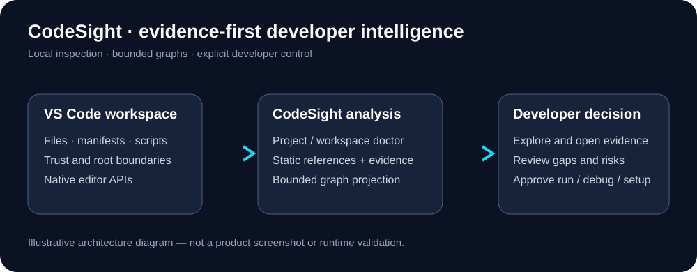

# CodeSight Architecture



## Runtime boundaries

CodeSight runs in the VS Code extension host and uses VS Code APIs for workspace discovery, documents, tasks, debugging, UI and trust. Static architecture analyzers are local modules; the Architecture Explorer presents their results in a CSP-restricted webview.

```text
VS Code Extension Host
  ├── Project Understanding / Workspace Doctor
  ├── Workstation / Native Capability / Prerequisite Engines
  ├── Run / Test / Debug / Task Lifecycle / Service Readiness
  └── Architecture Explorer
       ├── architecture-analyzers.js  (language patterns)
       ├── architecture-core.js       (nodes, edges, evidence, limits)
       ├── architecture-view-core.js  (bounded neighborhood)
       ├── architecture-visual-core.js (bounded layout)
       ├── architecture-navigation.js (known source + realpath containment)
       └── architecture-explorer.js   (scan + VS Code webview + source opening)
```

## Architecture Explorer flow

1. Check Workspace Trust and select an explicit workspace root.
2. Discover bounded candidate files using VS Code workspace APIs.
3. Validate relative paths and canonical filesystem containment; exclude symlink escapes.
4. Read bounded files and extract provisional language-specific static references.
5. Classify local, external and unresolved references; attach source-line evidence.
6. Build a bounded neighborhood and deterministic graph projection.
7. Render keyboard-accessible nodes, edges and evidence links.
8. Before opening a source, validate its known identity, workspace trust and containment again.

**Current limits:** default scan 300 files (configurable cap 1,000); 256 KiB/file by default (cap 1 MiB); graph projection 90 nodes / 180 edges. Some non-file virtual workspaces are currently rejected by canonical containment; do not claim universal remote workspace support.

## Security and ownership

Repository contents are untrusted data. Static scans do not execute discovered scripts. Running tasks and modifying configuration require deliberate developer action. Existing files are preserved. Evidence is provisional; neither source import nor a successful health probe proves a system-wide architecture guarantee.

## Current implementation limitations

The Architecture Explorer currently reconstructs the webview document on selection; fully progressive DOM updates are not yet implemented. Extension-host UI acceptance, large-repository measurements and packaged icon parity are release gates, not established results.

## Next stages

[A2 acceptance](CODESIGHT_A2_VSIX_ACCEPTANCE.md) → [A3 conformance](ROADMAP.md) → source-linked change-impact intelligence.
