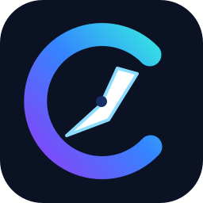

# CAssets CodeSight — Product Overview

**Tagline:** Understand your code. See dependencies. Develop with confidence.

**Publisher:** ClusterAssets · **Creator:** Vivek Rao Bhosale · **Package:** `cassets` · **Extension ID:** `clusterassets.cassets` · **VS Code display name:** `CAssets CodeSight — DevReady`.

## Mission

Reduce time spent discovering unfamiliar codebases, identifying setup gaps and guessing which commands or dependencies matter. Help experienced developers and AI-assisted developers validate their understanding against real source evidence, without replacing engineering judgment.

## Current product pillars

1. **Project Understanding:** languages, runtime and package manager signals, workspace packages, scripts and static source relationships.
2. **Workspace Doctor:** actionable prerequisite and configuration diagnostics.
3. **Run / Test / Debug:** reuse native VS Code facilities and existing repository commands with explicit consent.
4. **Architecture Explorer:** bounded graph navigation, filters, source-linked static evidence and provisional language coverage.

**Change Impact** and **A3 Architecture Conformance** are future milestones, not current verified capabilities.

## Target users

Developers onboarding to unfamiliar repositories, maintainers, technical leads, open-source contributors, and developers validating AI-assisted code changes.

## Metrics

Primary: time to verified first successful build and time to locate a source-backed dependency. Secondary: unnecessary setup avoided, navigation accuracy, scan latency, UI responsiveness, and security boundary violations.

## Boundaries

CodeSight is not an autonomous shell agent, IDE replacement, cloud repository uploader, architecture certification engine, secret manager or guaranteed runtime dependency tracer. Static references are hypotheses with evidence, not proof of runtime behavior.

See [Architecture](ARCHITECTURE.md), [Roadmap](ROADMAP.md) and [A2 acceptance](CODESIGHT_A2_VSIX_ACCEPTANCE.md).
