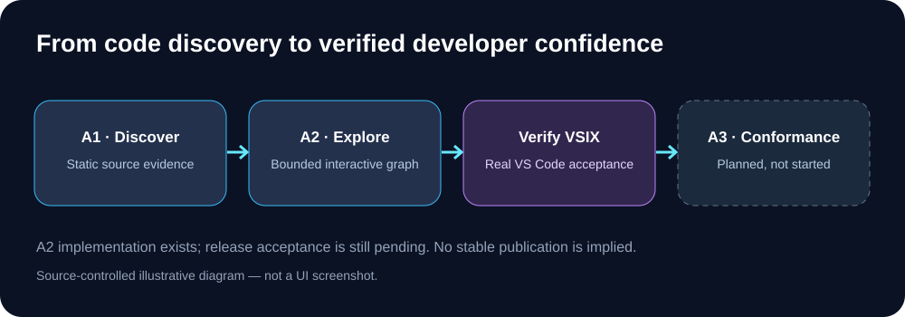

# CodeSight Roadmap

This roadmap separates **code merged**, **validated in CI**, **verified in real VS Code**, and **released**. Merging a PR does not automatically advance an acceptance gate.

## Completed implementation foundations

- **v0.1–v0.4:** workspace bootstrap, project baselines, public repository and release automation.
- **v0.5–v0.7:** developer intelligence, contributor onboarding, native-first workstation readiness.
- **Developer pillars:** project overview, workspace doctor, native task/debug integration, task lifecycle and service readiness implemented incrementally.
- **A1:** preliminary multi-language source-reference discovery with source evidence, unresolved/external classifications and explicit limitations.
- **A2 implementation to date:** bounded visual graph, filters, keyboard-operable nodes/edges, source navigation, multi-root isolation, symlink containment, viewport persistence and regression tests.

## A2 — Release-candidate acceptance (current gate)

**Status: pending, not accepted.**

| Workstream | Required evidence | State |
| --- | --- | --- |
| Security and correctness | Trust enforcement, root isolation, symlink escape rejection, bounded source opening | Implemented; end-to-end acceptance pending |
| Interactive UI | Selection, focus, zoom, pan, keyboard evidence navigation in VS Code | Manual/host validation pending |
| Rendering | Avoid full webview document recreation during selection; verify large graph responsiveness | Pending |
| Performance | Measured scans on large multi-language repositories and bounded memory | Pending |
| Packaging | Node 20/22 CI, extension-host checks, installable pre-release VSIX | Acceptance pending |
| Visual identity | Compare packaged PNG with approved CodeSight SVG at marketplace sizes | Pending |

**Gate:** [Install and verify the VSIX](CODESIGHT_A2_VSIX_ACCEPTANCE.md), record pass/fail evidence, and fix critical/high defects before declaring A2 complete.

## A3 — Evidence-based architecture conformance (not started)

Planned only after A2 acceptance:
- Developer-defined architecture constraints and allowed dependency directions.
- Compare observed static source relationships against explicit constraints.
- Report violations with navigable file/line evidence, confidence and false-positive controls.
- Distinguish verified constraints from inference; never claim runtime conformance from static scans alone.
- Read-only evaluation by default; no silent repository rewrites.

## Later — Change Impact and Incremental Intelligence

Research and design targets: bounded incremental indexing, source-backed change impact, multi-language parser upgrades, opt-in local context export for agents, and performance budgets. New dependencies require separate security and footprint review.

## Release discipline

- Keep existing repository files developer-owned.
- No automatic creation of AGENTS.md, CONTRIBUTING.md, policies or indexes without a concrete consumer and explicit action.
- Prefer native VS Code capabilities.
- Run CI and test the packaged extension in a clean VS Code profile before publication.
- Version and Marketplace publishing remain a separate, explicitly approved release action.
